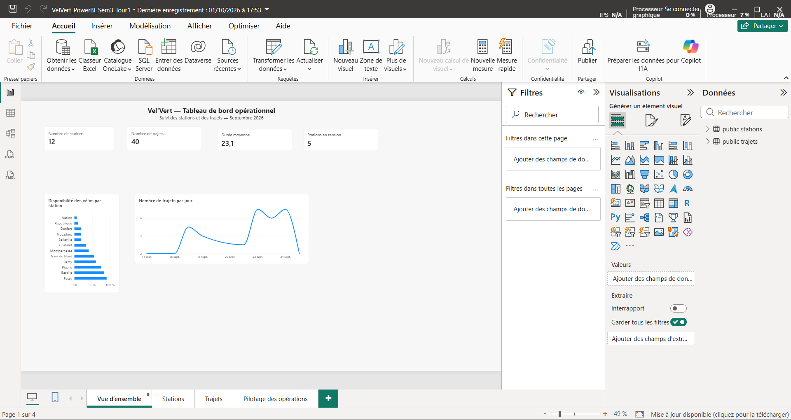
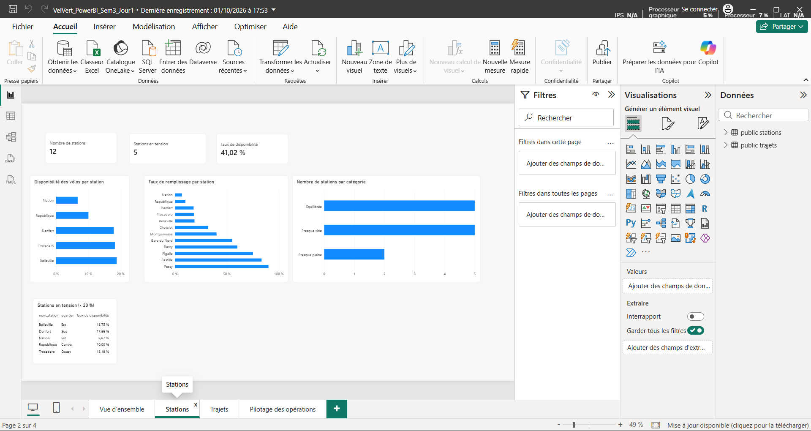
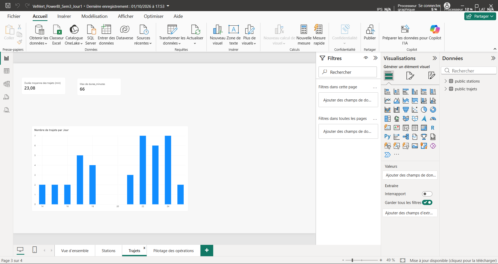
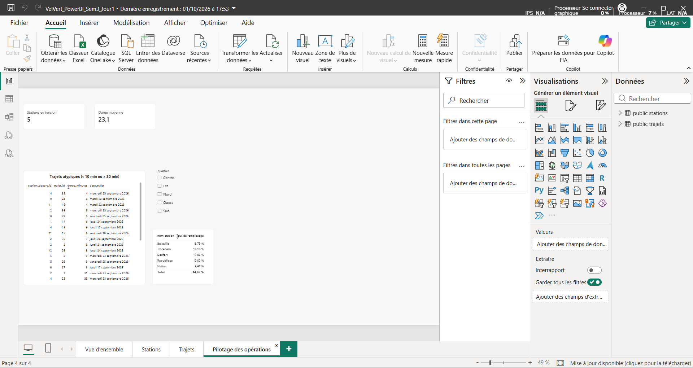

# Vel’Vert — Operational Analysis of an Electric Bike-Sharing Service

## Project overview

Vel’Vert operates a self-service electric bike-sharing fleet. This training project explores how SQL queries and a Power BI dashboard can help an operations team identify stations that need attention and understand usage patterns.

The work follows a practical data-analyst workflow: inspect the data dictionary, translate operational questions into SQL, execute and check queries, then communicate findings in a dashboard and a short operational note.

## Tools and skills

- **PostgreSQL** — querying station and trip data
- **SQL** — `SELECT`, `WHERE`, comparisons between columns, `AND` / `OR`, `ORDER BY`, and `LIMIT`
- **Python** — station-data collection script used earlier in the workflow
- **DBeaver** — database querying
- **Power BI** — dashboard design and operational reporting
- **Git** — local version control

## Dataset

The exercise uses two tables:

- `stations` — station names, available bikes, total capacity, neighbourhood, and installation date
- `trajets` — trip identifiers, departure station, trip duration, and trip date

The supplied exercise dataset contains **12 stations** and **40 trips**.

## SQL analysis

The weekly brief progresses from basic queries to business-oriented questions:

- Select station names and available-bike counts, or inspect all station columns.
- Filter stations by capacity, neighbourhood, and available-bike thresholds.
- Sort stations by capacity or name.
- Compare available bikes with total capacity to identify stations below 20% availability or above 80% occupancy.
- Filter and sort trips by duration and date.
- Combine conditions to flag potentially unusual trips, including trips shorter than 10 minutes or longer than 40 minutes.
- Define an explicit criterion for deciding which stations should be replenished first.

The priority query uses the availability rate — available bikes divided by total capacity — and sorts the stations with the lowest rate first. This makes the chosen operational criterion clear and reproducible.

## Power BI dashboard

The report contains four pages:

1. **Vue d’ensemble** — headline indicators and a daily trip trend.
2. **Stations** — station availability, fill rate, station categories, and stations under pressure.
3. **Trajets** — trip-duration indicators and the number of trips by day.
4. **Pilotage des opérations** — potentially atypical trips, a neighbourhood slicer, and a station fill-rate summary.

### Key findings shown in the report

- **12 stations** and **40 trips** are represented in the report.
- **5 stations out of 12** are below the 20% bike-availability threshold.
- The overall availability rate displayed on the Stations page is **41.02%**.
- The average trip duration is approximately **23 minutes**.
- The longest trip shown in the report lasts **66 minutes**.
- The operational page highlights trips outside the 10–30 minute range for review. The SQL exercise separately defines potential anomalies as trips shorter than 10 minutes or longer than 40 minutes; these are distinct thresholds used in different parts of the work.

## Dashboard screenshots

### Overview

### Stations

### Trips

### Operations management

## Operational recommendation

Start the Monday replenishment round with stations whose available-bike rate is below 20%, prioritising the lowest rate first. The station name, neighbourhood, available bikes, capacity, and calculated availability rate help the operations team understand both the location and the urgency.

## Limitations

These data describe the stations and trips captured in this exercise. They do not, by themselves, explain why a station has few bikes, predict future demand, or prove that an unusually short or long trip is an error. These findings should be checked against operational context before action is taken.

## Project deliverables

- `requetes_velvert.sql` — commented SQL queries from the weekly exercise
- `note_operations.md` — concise operational findings and recommendation
- Power BI report screenshots illustrating the four report pages

---

*Training project — Simplon Data Analyst Programme, 2026.*
